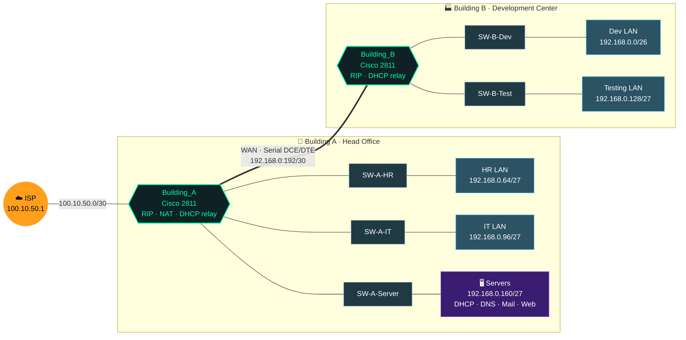

<div align="center">


<a href="https://git.io/typing-svg"></a>


</div>

---

```text
┌──────────────────────────────────────────────────────────────┐
│  PROJECT   : Multi-Service Campus Network                    │
│  CLIENT    : GreenTech Solutions Ltd. (software company)     │
│  TOOL      : Cisco Packet Tracer                             │
│  COURSE    : CSE405 - Networking, Dept. of CSE, EWU          │
│  STATUS    : ✔ All connectivity & service tests passed       │
└──────────────────────────────────────────────────────────────┘
```

## `01` &nbsp;Overview

GreenTech Solutions Ltd. runs a software-development campus split across **two buildings** joined by a WAN link. This project designs and implements the full network: hierarchical addressing, dynamic routing, centralized DHCP, internal DNS, email, a web server and internet access through NAT.

| 🏢 Building | 🧩 Department | 💻 Hosts | 🎯 Role |
|:--|:--|:--:|:--|
| **A** · Head Office | HR | 30 | End users |
| **A** · Head Office | IT | 30 | IT staff |
| **A** · Head Office | Server Room | – | DHCP · DNS · Email · Web |
| **B** · Development Center | Development | 60 | Dev team |
| **B** · Development Center | Testing | 30 | QA team |

## `02` &nbsp;Topology



<!-- Optional: add your Packet Tracer screenshot at docs/topology.png and uncomment the line below
<p align="center"></p>
-->

## `03` &nbsp;Objectives

- [x] Hierarchical IP plan using **VLSM** on `192.168.0.0/22`
- [x] **RIPv2** dynamic routing between the Building A and Building B routers
- [x] Centralized **DHCP** for all department LANs via `ip helper-address`
- [x] Internal **DNS** for `greentech.com`
- [x] Internal **Email** server with per-user accounts
- [x] **NAT overload (PAT)** on Router A using public IP `100.10.50.2`

## `04` &nbsp;Addressing Plan (VLSM)

Base block: **`192.168.0.0/22`**

| # | Subnet | Network | CIDR | Gateway | Broadcast |
|:-:|:--|:--|:-:|:--|:--|
| 1 | Development (B) | `192.168.0.0` | /26 | `192.168.0.1` | `192.168.0.63` |
| 2 | HR (A) | `192.168.0.64` | /27 | `192.168.0.65` | `192.168.0.95` |
| 3 | IT (A) | `192.168.0.96` | /27 | `192.168.0.97` | `192.168.0.127` |
| 4 | Testing (B) | `192.168.0.128` | /27 | `192.168.0.129` | `192.168.0.159` |
| 5 | Server Room (A) | `192.168.0.160` | /27 | `192.168.0.161` | `192.168.0.191` |
| 6 | WAN link (A ↔ B) | `192.168.0.192` | /30 | `.193` / `.194` | `192.168.0.195` |
| 7 | Public / ISP | `100.10.50.0` | /30 | `100.10.50.2` (NAT) | – |

> 💡 Subnets are allocated **largest-first** (60 → 30 → 30 → 30 → 30 → 2 hosts) so address space is not wasted.

## `05` &nbsp;Devices

| Device | Model | Location | Role |
|:--|:--|:--|:--|
| `Building_A` router | Cisco 2811 (+ NM-2FE2W) | Building A | Gateway · RIP · NAT · DHCP relay |
| `Building_B` router | Cisco 2811 | Building B | Gateway · RIP · DHCP relay |
| `SW-A-HR` · `SW-A-IT` · `SW-A-Server` | Cisco 2960 | Building A | Access switches |
| `SW-B-Dev` · `SW-B-Test` | Cisco 2960 | Building B | Access switches |
| Servers | Server-PT | Server Room | DHCP · DNS · Email · Web |

**Cabling:** straight-through for LAN links · Serial DCE/DTE for the WAN link.

## `06` &nbsp;Services

<table>
<tr>
<td width="50%" valign="top">

### 🛣️ Routing
`router rip` → `version 2` → `no auto-summary` on both routers

### 📡 DHCP
One server, one pool per department. Routers forward client broadcasts with `ip helper-address 192.168.0.162`

### 🌐 DNS
`www.greentech.com` and `mail.greentech.com` A-records pointing to the internal servers

</td>
<td width="50%" valign="top">

### ✉️ Email
SMTP (25) / POP3 (110) for `greentech.com`, with accounts such as `hr1`, `it1`, `dev1`

### 🌍 Web
HTTP server with a custom **"GreenTech Intranet"** landing page

### 🔁 NAT
PAT with ACL 1 permitting `192.168.0.0/22`, outside interface using `100.10.50.2`

</td>
</tr>
</table>

<details>
<summary><b>⚙️ Reference config snippets (click to expand)</b></summary>

<br/>

> Illustrative IOS snippets based on the design above. Interface names and exact addresses may differ in the `.pkt` file, so treat that file as the source of truth.

**RIPv2**
```text
Router(config)# router rip
Router(config-router)# version 2
Router(config-router)# no auto-summary
Router(config-router)# network 192.168.0.0
```

**DHCP relay** (on each LAN-facing interface)
```text
Router(config-if)# ip helper-address 192.168.0.162
```

**NAT overload (PAT)** on Building_A
```text
Router(config)# access-list 1 permit 192.168.0.0 0.0.3.255
Router(config)# ip nat inside source list 1 interface <outside-interface> overload
Router(config-if)# ip nat inside     ! on LAN-facing interfaces
Router(config-if)# ip nat outside    ! on the ISP-facing interface (100.10.50.2)
```

</details>

## `07` &nbsp;Test Results

```text
$ ./run_tests.sh
```

| ✔ | Test | Source → Destination | Method | Result |
|:-:|:--|:--|:--|:--|
| ✅ | Inter-building routing | PC0 (HR) → PC4 (Dev) | Ping | **Successful** |
| ✅ | DHCP assignment | All PCs → Server | Auto-config | **IP, mask, gateway assigned** |
| ✅ | Web access | PC7 (Testing) → Web server | Browser | **Page loaded** |
| ✅ | Email | PC2 (IT) → PC6 (Testing) | Email client | **Sent and received** |
| ✅ | Internet access (NAT) | PC0 (HR) → 100.10.50.1 | Ping / Simulation | **Source translated to 100.10.50.2** |

```text
5 passed, 0 failed
```

## `08` &nbsp;Repository Contents

```text
.
├── GreenTech_Network.pkt     # Packet Tracer simulation file
├── docs/
│   ├── Project_Report.pdf    # Full lab report with configs and screenshots
│   └── topology.png          # Topology screenshot
└── README.md
```

## `09` &nbsp;How to Run

1. Install [Cisco Packet Tracer](https://www.netacad.com/courses/packet-tracer) (free with a Cisco Networking Academy account)
2. Open `GreenTech_Network.pkt`
3. Wait for the link lights to turn green, then try:

| Where | What to do |
|:--|:--|
| Any PC → **Desktop → IP Configuration** | Select **DHCP** |
| **Desktop → Command Prompt** | `ping 192.168.0.1` (cross-building) |
| **Desktop → Web Browser** | `http://www.greentech.com` |
| **Desktop → Email** | Server `mail.greentech.com`, then send a message |

## `10` &nbsp;Notes

> ⚠️ The report's router-interface table and some server addresses differ slightly from the VLSM table and topology screenshot (a documentation inconsistency). The VLSM table above matches the working `.pkt` topology. Open the `.pkt` file for the authoritative addresses.

> 📚 Built for coursework and learning in a simulator, not for production use.

---

<div align="center">

### 👤 Author

**Anik Saha**<br/>
Department of CSE, East West University

[](https://github.com/info-AnikSaha)

<sub>⭐ Star this repo if it helped you with your own networking lab!</sub>


</div>

